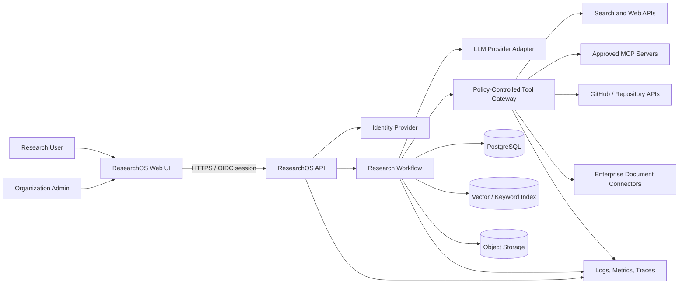
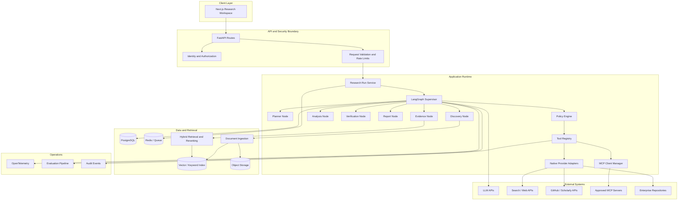
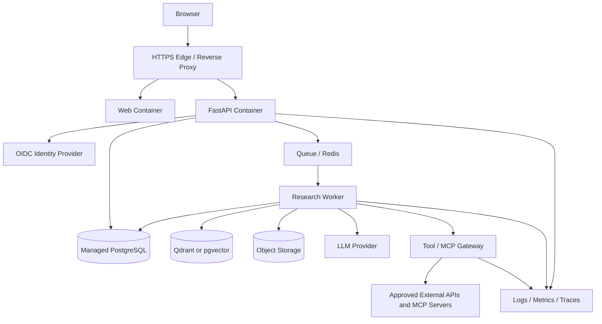
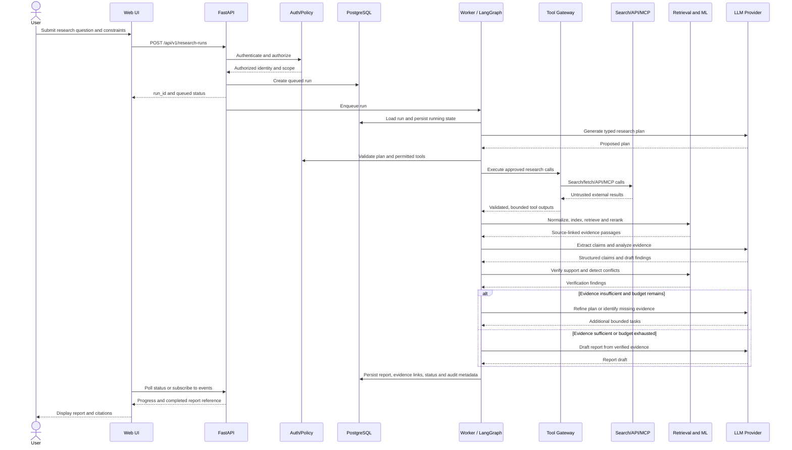
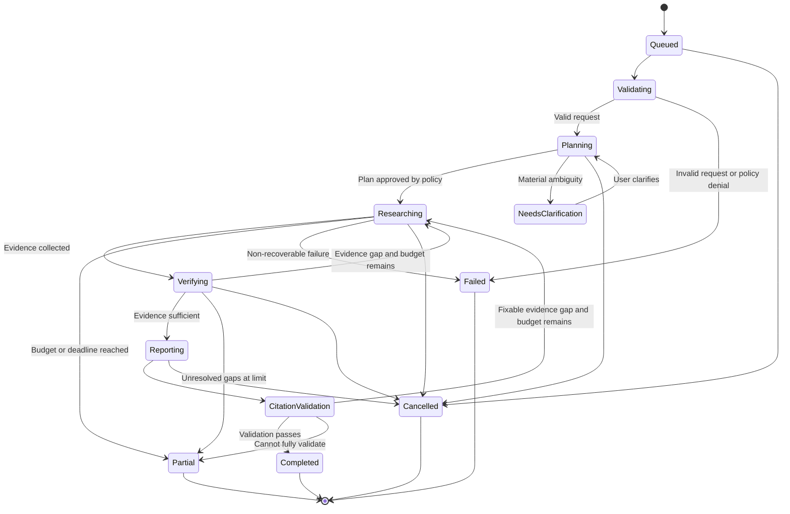
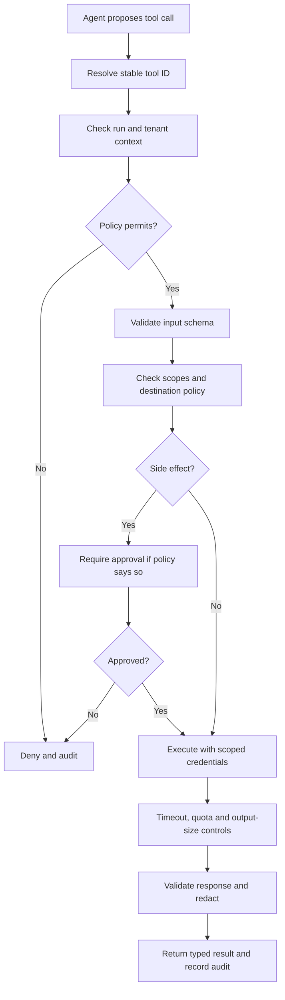
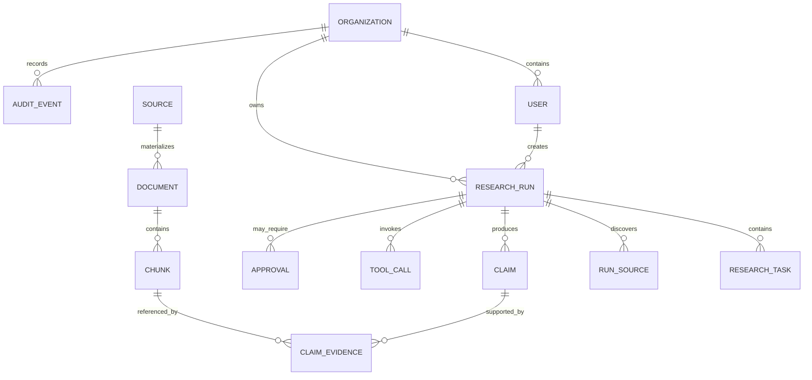
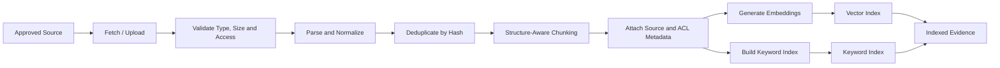
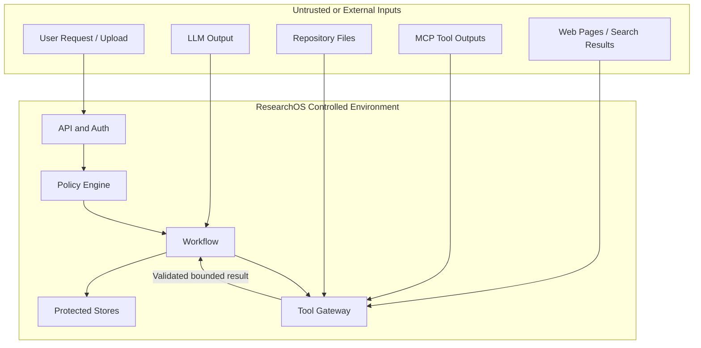

# ResearchOS Architecture
## Enterprise Research Intelligence Agent

- **Document status:** Architecture baseline for implementation
- **Version:** 1.0
- **Last updated:** 2026-10-19
- **Related documents:** `AGENTS.md`, `PRD.md`, `TRD.md`, `changes.md`, `task.md`, `requirements.txt`
- **Architecture style:** Supervisor-led, graph-orchestrated modular monolith with background workers
- **Primary runtime:** Python 3.11+, FastAPI, LangGraph
- **Frontend:** Next.js, React, TypeScript
- **Primary data store:** PostgreSQL
- **Retrieval:** Hybrid keyword and vector retrieval, with reranking
- **Integration model:** Native API adapters plus approved MCP clients

> This document describes the intended architecture and boundaries. It is not proof that every component has been implemented, deployed, load-tested, or security-reviewed. Unconfirmed provider and infrastructure choices remain configurable decisions.

---

# 1. Purpose and architectural goals

ResearchOS converts complex research questions into structured, evidence-backed reports. It coordinates approved research tools, APIs, MCP servers, retrieval systems, ML components, and verification steps while preserving source provenance and enforcing security policies.

The architecture is designed to optimize for:

1. **Evidence traceability:** Every important conclusion should be traceable to source passages or explicitly marked as unsupported.
2. **Controlled autonomy:** Agents can plan and perform bounded work but cannot bypass deterministic authorization, budget, and approval controls.
3. **Composable integrations:** Search providers, LLMs, vector stores, and MCP servers can be replaced through adapters.
4. **Reproducibility:** Research runs preserve plans, workflow versions, source metadata, tool outcomes, and evaluation results.
5. **Failure containment:** Provider errors, malformed model outputs, and unsafe tool requests should fail visibly and safely.
6. **Tenant isolation:** User and organization boundaries apply to API access, documents, retrieval, reports, traces, and tool execution.
7. **Measured quality:** Retrieval, claim support, citation correctness, latency, and cost are evaluated rather than assumed.
8. **Practical delivery:** Start with a modular monolith and a small set of services; split services only when justified by measured scale or isolation needs.

## 1.1 Architectural non-goals

- Training a foundation model from scratch.
- Unrestricted shell, Python, or browser execution initiated by an LLM.
- Treating LLM-generated confidence as ground truth.
- Automatically publishing, sending, deleting, or modifying external resources without explicit policy and approval.
- Starting with a large microservice fleet or Kubernetes before operational needs justify it.
- Promising complete factual correctness from an automated system.

---

# 2. System context and external actors

## 2.1 Actors

| Actor | Purpose | Trust boundary |
|---|---|---|
| Research user | Submits questions, reviews evidence, exports reports | Authenticated user; authorization is scoped to permitted projects and tenants |
| Organization administrator | Manages membership, integrations, policies, and retention settings | Privileged role; actions are audited |
| ResearchOS web client | Displays progress, evidence, and reports | Untrusted client; cannot assert identity or permissions |
| Identity provider | Authenticates users and issues identity claims | External trust provider; tokens must be validated |
| LLM provider | Performs planning, extraction, analysis, and report synthesis | External processor; prompts and outputs require data governance |
| Search/API providers | Return public or licensed research material | External, variable reliability, subject to quotas and terms |
| MCP servers | Expose tools through the Model Context Protocol | Explicitly configured integration boundary; never inherently trusted |
| Enterprise data systems | Provide authorized internal documents and records | Source ACLs and tenant permissions must be preserved |
| Operations team | Monitors deployments, incidents, usage, and quality | Privileged operational access is audited |

## 2.2 System context diagram



External content is evidence, not authority. Instructions found in web pages, documents, repositories, model outputs, or MCP responses must never override application policy.

---

# 3. High-level architecture

## 3.1 Logical layers

### Layer A: Experience
- Next.js and React web application.
- Research request form, scope/constraints editor, run timeline, source inspector, report viewer, approval interface, and evaluation dashboard.
- Uses authenticated APIs and optional Server-Sent Events (SSE) for progress.
- Does not contain provider credentials or trusted authorization logic.

### Layer B: API and identity boundary
- FastAPI routes and Pydantic request/response models.
- Authentication integration using a selected OIDC/OAuth provider or trusted identity gateway.
- Authorization for every run, source, report, approval, and organization resource.
- Request limits, correlation IDs, API versioning, and validation.
- Creates research-run records and schedules background execution.

### Layer C: Orchestration
- LangGraph-based workflow with explicit state and transitions.
- Planner decomposes questions into research tasks.
- Supervisor selects eligible work, enforces stop conditions, and schedules safe parallel tasks.
- Verification/completeness nodes decide whether to research more, request clarification, or produce a partial report.
- State is checkpointed using a configured durable checkpointer and/or application persistence.

### Layer D: Agents and domain services
- Planner, discovery, evidence extraction, analysis, verification, and report-generation nodes.
- Skills provide versioned procedures and quality criteria.
- Domain services perform deterministic operations such as URL canonicalization, numeric normalization, citation validation, and policy checks.
- Agents do not receive unrestricted database or network access.

### Layer E: Tool and MCP gateway
- Registry of approved tools and MCP servers.
- Schema validation, authorization, scoped credentials, destination restrictions, rate limits, timeouts, cancellation, output limits, and audit logging.
- Native REST/SDK adapters are used when they provide clearer contracts or better security controls than an MCP integration.
- Read-only operations are the default. Side-effecting operations require explicit approval and policy authorization.

### Layer F: Retrieval and ML
- Ingestion and normalization of source content.
- Structure-aware chunking and metadata preservation.
- Embeddings, keyword retrieval, hybrid fusion, reranking, claim extraction, contradiction analysis, and evaluation.
- ML outputs are signals; critical conclusions require evidence and validation.

### Layer G: Persistence and operations
- PostgreSQL for transactional metadata and workflow records.
- One selected vector retrieval backend, such as Qdrant or pgvector.
- Object storage for original files and report artifacts.
- Redis for cache and queue coordination where required.
- OpenTelemetry-compatible tracing, structured logs, metrics, alerts, and evaluation records.

## 3.2 Component diagram



The diagram shows logical boundaries, not a requirement that every node run as a separate deployable service.

---

# 4. Recommended deployment topology

## 4.1 MVP topology

Deploy a small number of independently restartable processes:

1. **Web:** Next.js application.
2. **API:** FastAPI request/identity layer.
3. **Worker:** Background research workflow execution.
4. **PostgreSQL:** Transactional metadata and run records.
5. **Redis:** Optional queue/cache; not the sole durable source of truth.
6. **Vector store:** One selected backend if not using pgvector.
7. **Object storage:** Managed or S3-compatible storage for files and artifacts.
8. **External providers:** LLM, search, MCP, and approved connectors.
9. **Observability backend:** Hosted or self-managed logs/traces/metrics.

Use managed services where practical for backups, TLS, patching, and operational simplicity. Keep local development reproducible with Docker Compose.

## 4.2 Deployment diagram



## 4.3 Environment separation

- **Development:** Local test credentials, seeded non-sensitive data, mock providers where appropriate.
- **Test/CI:** Deterministic provider mocks and isolated temporary databases; selected integration tests may use controlled test credentials.
- **Staging:** Production-like configuration, access controls, migrations, monitoring, and adversarial tests.
- **Production:** Managed secrets, least privilege, backups, retention policies, alerting, controlled migrations, and documented rollback.

Never reuse production credentials in local development or expose internal services directly to the public internet.

---

# 5. End-to-end research workflow

## 5.1 Primary sequence



## 5.2 Workflow state machine



A run status is a persisted business state, not merely a UI label. State transitions must be validated and recorded. Cancellation should be cooperative and must not imply that already completed external side effects have been undone.

## 5.3 Research planning contract

The planner should produce a validated object with:

- Research objective and scope.
- Atomic research questions.
- Source types required for each question.
- Dependencies between tasks.
- Suggested tool IDs from the approved registry.
- Expected evidence and completion criteria.
- Freshness requirements where relevant.
- Risk/permission classification.
- Estimated task budget and stop conditions.

The model may propose tasks and tools. The application determines whether those tasks and tools are allowed.

## 5.4 Bounded execution policy

Every run must have server-enforced limits for:

- Maximum graph steps.
- Maximum elapsed time.
- Maximum tool calls overall and per provider.
- Maximum document bytes, pages, and extracted text.
- Maximum parallel tasks.
- Maximum model token or monetary budget where usage data is available.
- Maximum retries per operation.
- Maximum output size.
- Cancellation and user-approval wait time.

If a budget is exhausted, stop safely and produce a partial result with unresolved questions rather than continuing indefinitely.

---

# 6. Agent architecture and responsibility boundaries

## 6.1 Supervisor

**Responsibilities**
- Own the workflow state and graph transitions.
- Schedule eligible tasks and safe parallel operations.
- Apply deadlines, budgets, retry limits, and cancellation.
- Route incomplete evidence to further research when budget remains.
- Persist progress and emit traceable events.

**Must not**
- Bypass the policy engine.
- Invent successful tool outcomes.
- continue a loop without an explicit stopping condition.
- Grant itself new permissions.

## 6.2 Planner agent

Creates research questions, task dependencies, and evidence criteria. Its output must pass schema validation and policy checks before execution.

## 6.3 Discovery agent

Chooses among already-approved source adapters and proposes searches. It does not receive raw provider secrets and cannot call arbitrary URLs without gateway policy.

## 6.4 Evidence agent

Normalizes source results, extracts claims, attaches exact source and passage references, and distinguishes direct evidence from inference. It must preserve contradictory passages rather than discard them merely because they conflict with a preferred conclusion.

## 6.5 Analysis agent

Compares evidence, calculates deterministic metrics where possible, applies an explicit comparison rubric, and explains trade-offs. Numerical calculations should be performed by deterministic code, not guessed by an LLM.

## 6.6 Verification agent

Checks whether each important claim is supported by cited evidence, whether the evidence actually entails the claim, whether dates and scopes align, and whether counter-evidence exists. Its outcome should be a typed status such as `supported`, `contradicted`, `insufficient_evidence`, or `needs_human_review`.

## 6.7 Report agent

Generates a report from validated claims and evidence records. It must not create new factual claims that are absent from the evidence set without marking them as analysis or uncertainty.

## 6.8 Deterministic services

These are ordinary code modules, not autonomous agents:

- Authorization and policy decisions.
- Input/output schema validation.
- Numeric and date normalization.
- Citation target validation.
- Budget accounting.
- URL and network restrictions.
- Tenant filtering.
- Audit event generation.
- Report formatting and export.

Keep security decisions and exact calculations in deterministic code whenever practical.

---

# 7. Tool and MCP architecture

## 7.1 Tool execution boundary

All agent-initiated tool calls pass through one controlled execution path:



## 7.2 Tool registry metadata

Each registered tool should declare:

- Stable ID and version.
- Provider/server identity.
- Input and output schema.
- Required scopes and resource permissions.
- Read/write/side-effect classification.
- Allowed tenant or project context.
- Destination/network restrictions.
- Timeout, retry, concurrency, and rate-limit policy.
- Idempotency characteristics.
- Data sensitivity classification.
- Approval requirements.
- Logging/redaction policy.
- Owner and operational contact.

## 7.3 Candidate integrations

Enable integrations incrementally after checking the current server, provider, terms, permissions, and maintenance status.

| Integration | Example capabilities | Default posture |
|---|---|---|
| Web search provider | Search queries, news, source discovery | Read-only; provider quotas apply |
| Browser/fetch adapter | Retrieve and parse allowed pages | Isolated; restricted egress |
| GitHub API/MCP | Repository metadata, files, issues, releases | Read-only and repository-scoped |
| Scholarly APIs | Paper metadata, abstracts, citations | Read-only; respect provider limits |
| PostgreSQL connector | Approved schema inspection and read-only queries | Read-only DB role and query limits |
| Enterprise document connector | Search/read authorized documents | Preserve source ACLs |
| Knowledge workspace connector | Read pages; optionally publish reports | Writes require approval and scoped permissions |

MCP is a protocol for tool/context integration, not a guarantee that a server or tool is safe. Review each server and enforce application policy independently.

## 7.4 Native API versus MCP

Use MCP when standard tool discovery and interoperability provide value. Use a native provider adapter when it offers clearer typed contracts, required provider features, or simpler operational controls. Both paths must use the same policy and audit boundary.

Never expose all discovered MCP tools automatically to every agent. Filter available tools by task, role, tenant, risk class, and configured allowlist.

---

# 8. Data architecture and information lifecycle

## 8.1 System of record

PostgreSQL is the source of truth for transactional metadata. Vector indexes and caches are derived systems and can be rebuilt from retained source/chunk records when designed accordingly.

Object storage holds original files and large report artifacts. The database should store references, metadata, hashes, and access-control relationships rather than unnecessarily duplicating large binary objects.

## 8.2 Core entities and relationships



Suggested logical entities:

- `organizations`: tenant and organization metadata.
- `users`: identity-provider subject and organization membership.
- `research_runs`: request, scope, workflow version, budget, status, timestamps.
- `research_tasks`: typed tasks, dependencies, attempts, status, outputs.
- `sources`: canonical URI, type, title, publication/retrieval timestamps, content hash.
- `documents`: parsed source version, object-storage reference, processing state.
- `chunks`: text, location metadata, content hash, embedding model/version.
- `claims`: atomic statement, normalized value, verification status, uncertainty rationale.
- `claim_evidence`: support/contradiction/context relationships to passages.
- `tool_calls`: tool identity, redacted arguments, status, duration, error class.
- `approvals`: requested action, approver, decision, timestamps.
- `audit_events`: actor, action, resource, timestamp, correlation ID.
- `reports`: report version, content/object reference, validation state, source run.

The final physical schema and constraints must be defined in migrations and the TRD. Do not rely on this conceptual diagram as a database migration.

## 8.3 Source provenance

Every source should preserve as available:

- Canonical URL or internal source ID.
- Provider/source type.
- Title and publisher/author metadata.
- Publication date and retrieval timestamp.
- Content hash and version information.
- License/usage metadata when provided.
- Tenant and source access policy.
- Parser version and processing status.

Every chunk should preserve:
- Source/document ID.
- Stable chunk ID and chunking version.
- Page, heading, paragraph, or offset location.
- Text hash and embedding model/version.
- Access metadata inherited from the source.

Every claim-evidence link should preserve:
- Claim ID.
- Supporting, contradicting, or contextual relationship.
- Passage/chunk ID.
- Explanation or verification rationale.
- Verification model/rule version and timestamp when relevant.

## 8.4 Retention and deletion

Retention policies must cover original documents, extracted text, embeddings, reports, run state, traces, caches, and audit events. Deleting or revoking access to a source must invalidate derived retrieval records according to the defined policy. Audit retention may differ from content retention, but must be documented and compliant with applicable requirements.

---

# 9. RAG and AI/ML architecture

## 9.1 Ingestion pipeline



Pipeline requirements:
- Restrict file types, sizes, parser runtime, and outbound fetch destinations.
- Preserve page/section locations.
- Use stable hashes for deduplication and content change detection.
- Record parser and chunking versions.
- Apply source permissions before any content is returned to an agent.
- Make ingestion idempotent where practical.
- Record partial parser failures and avoid representing incomplete ingestion as complete.

## 9.2 Retrieval pipeline

1. Normalize the question and identify retrieval constraints.
2. Apply authorization and tenant filters.
3. Retrieve lexical candidates using BM25 or PostgreSQL full-text search.
4. Retrieve semantic candidates using the selected embedding model and vector index.
5. Fuse candidates using a measured method such as reciprocal-rank fusion.
6. Deduplicate overlapping or repeated passages.
7. Rerank candidates using a cross-encoder or evaluated ranking model.
8. Return a bounded evidence pack with exact source references and location metadata.
9. Log retrieval statistics and evaluation outcomes without unnecessary sensitive text.

## 9.3 Model responsibilities

| Capability | Initial approach | Quality control |
|---|---|---|
| Planning | LLM with typed structured output | Validate tasks, tool IDs, budgets, and dependencies |
| Embeddings | Configurable pretrained embedding model or hosted API | Evaluate retrieval on a labeled set |
| Keyword retrieval | BM25 or database full-text search | Recall@K and NDCG@K |
| Reranking | Pretrained cross-encoder where feasible | Compare against no-reranker baseline |
| Claim extraction | LLM structured extraction; optional NER model | Schema validation and source-span checks |
| Contradiction analysis | Numeric/date rules plus NLI or LLM verifier | Labeled contradiction set and human review |
| Evidence prioritization | Interpretable source/relevance/freshness features | Evaluate calibration and ranking quality |
| Report synthesis | LLM constrained to validated evidence | Citation validation and claim-support evaluation |

## 9.4 Contradiction handling

A difference between sources is not automatically a contradiction. The system should distinguish:

- Direct factual contradiction.
- Change over time.
- Different product/version or population.
- Different measurement definitions or units.
- Different scope or assumptions.
- One source lacking sufficient detail.
- A claim unsupported by either source.

Numeric comparisons should normalize units and time windows in deterministic code. NLI and LLM judgments should be recorded as model-derived assessments and checked against source passages.

## 9.5 Evidence score design

An evidence score may prioritize review using features such as relevance, directness of support, source type, freshness, independent corroboration, and scope match. Do not treat domain reputation as proof, and do not count syndicated copies of the same source as independent corroboration.

Do not label a score as a probability of truth unless it has been calibrated and validated against a representative labeled dataset.

## 9.6 Model routing and cost controls

Use configurable model adapters. Route simple extraction or classification tasks to lower-cost models when evaluation shows acceptable quality; reserve stronger models for complex synthesis and ambiguous verification. Model routing must be measured and versioned.

Record model ID, prompt/skill version, token usage where available, latency, and estimated cost. Avoid storing sensitive prompts by default.

---

# 10. Skills and prompt architecture

Skills are version-controlled procedures for recurring work, not a replacement for tool policy or application code.

Candidate skills:

- `research-planning`
- `source-discovery`
- `evidence-extraction`
- `comparative-analysis`
- `claim-verification`
- `secure-tool-use`
- `research-reporting`

Each skill should define:
1. Purpose and allowed scope.
2. Required inputs and validated output schema.
3. Procedure and decision criteria.
4. Tools it may request, subject to policy.
5. Failure cases and abstention behavior.
6. Quality checklist.
7. Version and evaluation cases.

Keep system instructions, skill instructions, user requests, and retrieved evidence logically separate. Retrieved content must never be concatenated into trusted instructions as if it were policy. Prompt templates should be versioned, reviewed, and tested with adversarial examples.

---

# 11. Security architecture and trust boundaries

## 11.1 Security controls

### Identity and authorization
- Use a selected OIDC/OAuth integration or trusted identity gateway.
- Validate issuer, audience, expiry, signature, and required claims.
- Derive tenant and user identity from verified identity context.
- Enforce authorization on every object access and tool call.
- Use role-based or attribute-based policy as requirements demand.
- Preserve source-system permissions for connected documents.

### Tool and network security
- Allowlist MCP servers, tools, and provider endpoints.
- Use scoped credentials and read-only roles by default.
- Block private/internal IP ranges and unsafe redirects for general web fetches, unless an explicitly approved internal connector requires them.
- Apply DNS and destination validation against SSRF.
- Restrict browser/container egress.
- Apply tool timeouts, quotas, payload limits, and cancellation.
- Require approval for external writes or other consequential actions.

### Prompt-injection resistance
- Treat retrieved content as untrusted data.
- Never permit a document to grant permissions or redefine agent policy.
- Minimize the tools available to each task.
- Keep secrets outside model context.
- Use separate review paths for high-risk tool calls.
- Test direct and indirect prompt injection from pages, PDFs, code repositories, and MCP results.

### Data protection
- Encrypt traffic in transit and use platform/storage encryption at rest.
- Redact credentials and sensitive values from logs.
- Define document and report retention/deletion.
- Avoid cross-tenant caches unless cache keys include authorization context and the design is proven safe.
- Audit privileged actions and access to sensitive evidence.

## 11.2 Trust boundary diagram



The diagram's trust boundary does not imply that an external LLM provider is trusted with every data category. Provider selection and data processing must follow organization policy.

## 11.3 Approval model

A policy engine classifies operations:
- **Read-only, low risk:** May execute automatically within scope and quota.
- **Sensitive read:** Requires explicit permission and potentially user confirmation.
- **External write or publication:** Requires explicit approval and an auditable decision.
- **Disallowed:** Denied, regardless of agent request.

Approval records must bind to the exact proposed action, target resource, arguments or argument hash, requester, approver, and expiry. If the action changes after approval, request a new approval.

---

# 12. API and event architecture

## 12.1 REST API baseline

All routes should be versioned under `/api/v1`.

| Method | Route | Purpose |
|---|---|---|
| `POST` | `/api/v1/research-runs` | Create a research run |
| `GET` | `/api/v1/research-runs/{run_id}` | Read run status and summary |
| `GET` | `/api/v1/research-runs/{run_id}/events` | Stream run events using SSE if enabled |
| `GET` | `/api/v1/research-runs/{run_id}/evidence` | Retrieve authorized evidence |
| `GET` | `/api/v1/research-runs/{run_id}/report` | Retrieve validated report |
| `POST` | `/api/v1/research-runs/{run_id}/cancel` | Request cancellation |
| `POST` | `/api/v1/research-runs/{run_id}/approvals/{approval_id}` | Approve or reject a pending action |
| `GET` | `/health/live` | Process liveness |
| `GET` | `/health/ready` | Dependency readiness |

The exact API contract must be implemented with Pydantic schemas and documented in OpenAPI. Never accept client-supplied tenant IDs as proof of access.

## 12.2 Event types

Use a small versioned event vocabulary, for example:

- `run.queued`
- `run.started`
- `run.stage_changed`
- `task.started`
- `task.completed`
- `tool.started`
- `tool.completed`
- `evidence.added`
- `verification.completed`
- `approval.required`
- `run.partial`
- `run.completed`
- `run.failed`
- `run.cancelled`

Events should include a run ID, event ID, timestamp, schema version, and safe metadata. Do not stream secrets, full sensitive documents, or unredacted tool arguments.

---

# 13. Reliability, failure handling, and recovery

## 13.1 Failure categories

| Failure | Expected behavior |
|---|---|
| Invalid user request | Return validation errors before starting expensive work |
| Authorization denial | Fail closed and record a safe audit event |
| Search provider rate limit | Respect retry hints, back off within budget, then report partial coverage |
| Provider timeout | Cancel the request when supported; record timeout and continue only if safe |
| MCP server unavailable | Mark that connector unavailable; do not silently claim it was searched |
| Malformed model output | Validate, retry within a strict limit, then fail that node or use a safe fallback |
| Parser error | Record document-level failure and preserve source status |
| Vector store unavailable | Use a documented fallback only if quality/security permit; otherwise stop affected retrieval |
| Budget exhausted | Stop research and return partial output with unresolved gaps |
| Worker restart | Resume from durable state where supported; make repeated steps idempotent |
| Citation validation failure | Repair from stored evidence or mark report partial; do not fabricate citations |
| Cancellation | Stop future work cooperatively and record final state |

## 13.2 Idempotency and retries

- Use idempotency keys for run creation where appropriate.
- Persist state transitions transactionally.
- Retry only transient failures and cap attempts.
- Use exponential backoff with jitter for eligible operations.
- Never automatically repeat an external write without idempotency guarantees or renewed approval.
- Store provider request IDs when available for support and incident investigation.

## 13.3 Partial completion

A partial report must clearly state:
- Which research questions were completed.
- Which source types or providers were unavailable.
- Which claims remain unverified or conflicted.
- Which budgets or deadlines were reached.
- What additional work would be required.

Do not present partial coverage as exhaustive research.

---

# 14. Observability and auditability

## 14.1 Trace model

A research run should map to a root trace. Workflow nodes, model calls, retrieval operations, tool calls, and report validation should be child spans or linked trace events.

Capture:
- `run_id`, tenant-safe correlation ID, workflow version.
- Node/tool/provider name and version.
- Start/end time, duration, status, retry count.
- Model identifier and token/cost metadata where available.
- Retrieval candidate counts and rank metrics where applicable.
- Error category and sanitized diagnostic details.
- Verification result and citation validation summary.

## 14.2 Logging policy

- Use structured logs.
- Redact credentials, access tokens, private keys, and sensitive payloads.
- Avoid full prompt/document logging by default.
- Restrict trace access by role and tenant.
- Establish retention periods for traces and audit logs.
- Keep security audit records distinct from noisy diagnostic logs.

## 14.3 Operational dashboards

At minimum, monitor:
- API request rate, errors, and latency.
- Queue depth and worker saturation.
- Research run completion/partial/failure rate.
- Provider latency, rate-limit errors, and availability.
- Tool call count and failure rate.
- Model usage and cost per run.
- Retrieval latency and index failures.
- Citation validation failure rate.
- Security denials and suspicious tool-call patterns.

Alert thresholds should be based on observed baselines and service objectives, not arbitrary values.

---

# 15. Evaluation architecture

## 15.1 Evaluation layers

1. **Unit evaluation:** Deterministic functions, schemas, chunking, normalization, and policy checks.
2. **Retrieval evaluation:** Recall@K, Precision@K where labels exist, and NDCG@K.
3. **Claim evaluation:** Claim extraction correctness and source-span validity.
4. **Citation evaluation:** Citation resolution and whether the cited passage supports the claim.
5. **Contradiction evaluation:** Precision/recall on a labeled conflict set.
6. **Agent evaluation:** Tool selection, workflow completion, stopping behavior, and recovery from tool failure.
7. **Security evaluation:** Prompt injection, SSRF, cross-tenant access, secret leakage, and unauthorized side effects.
8. **Operational evaluation:** Latency, cost, concurrency, retries, and recovery after restart.

## 15.2 Evaluation dataset

Maintain versioned cases with:
- User question and scope.
- Expected research subquestions.
- Gold sources or evidence passages where possible.
- Expected claims and known counter-evidence.
- Acceptable answer criteria.
- Security/adversarial input labels.
- Evaluation version and reviewer notes.

Use human-reviewed examples as a reference set. LLM-as-judge may help triage but must not be the only correctness metric.

## 15.3 Release gates

Set quantitative thresholds only after establishing a representative baseline. A release should not proceed if it introduces a serious authorization bypass, leaks secrets, fabricates citations in a known test case, or breaks core workflow invariants, even if aggregate quality scores improve.

---

# 16. Scaling strategy

## 16.1 Initial scale

Start with:
- One API deployment.
- One or more background workers.
- PostgreSQL with indexes and backups.
- One vector store.
- Redis/queue if required.
- Managed object storage and provider APIs.

Scale workers horizontally based on queue depth and provider quotas. Use concurrency limits per provider to avoid triggering rate limits.

## 16.2 Scale-out triggers

Consider separating components only when metrics show a need:
- Ingestion requires different CPU/memory or security isolation.
- Retrieval needs independent capacity or deployment cadence.
- A provider adapter has unique scaling or network constraints.
- Worker queue latency exceeds the service objective.
- Team ownership and release cycles require independent services.

Do not split services simply because they are represented as separate boxes in a logical diagram.

## 16.3 Capacity considerations

- LLM and search provider quotas may become the first bottleneck.
- PDF parsing and embedding generation may be CPU/GPU-intensive.
- Vector index size and retrieval latency depend on corpus size and embedding dimensions.
- Long-running jobs require durable state and cancellation.
- Tenant-specific data filters can affect retrieval index design.
- Caching must account for tenant permissions, source freshness, and model/prompt versions.

Load-test representative workloads before making capacity promises.

---

# 17. Repository mapping

Recommended logical mapping for the architecture:

```text
researchos/
├── AGENTS.md
├── PRD.md
├── TRD.md
├── ARCHITECTURE.md
├── changes.md
├── task.md
├── requirements.txt
├── .env.example
├── pyproject.toml
├── docker-compose.yml
├── apps/
│   ├── api/
│   └── web/
├── services/
│   ├── worker/
│   └── ingestion/
├── src/researchos/
│   ├── agents/
│   ├── orchestration/
│   ├── tools/
│   ├── mcp/
│   ├── retrieval/
│   ├── ingestion/
│   ├── ml/
│   ├── security/
│   ├── storage/
│   ├── evaluation/
│   ├── observability/
│   ├── schemas/
│   └── config.py
├── migrations/
├── tests/
│   ├── unit/
│   ├── integration/
│   ├── security/
│   └── evaluation/
├── infra/
│   ├── docker/
│   └── deployment/
└── docs/
    ├── API.md
    ├── THREAT_MODEL.md
    ├── EVALUATION_PLAN.md
    ├── RUNBOOK.md
    └── DATA_RETENTION.md
```

This is a target layout. The implementation should follow existing repository conventions and avoid duplicating modules if equivalent ones already exist.

---

# 18. Architecture decisions and open choices

## 18.1 Baseline decisions

| Decision | Baseline | Rationale |
|---|---|---|
| Application shape | Modular monolith plus worker | Easier to build, test, and operate initially |
| Orchestration | Explicit graph workflow | Bounded loops, inspectable state, conditional routing |
| API | FastAPI with typed schemas | Python ecosystem and validation |
| Transactional store | PostgreSQL | Durable metadata and relational constraints |
| Retrieval | Hybrid keyword + vector + reranker | Better balance of lexical and semantic matching |
| Tool boundary | Central policy-controlled gateway | Consistent permissions, limits, and auditing |
| Source of truth | PostgreSQL plus immutable/object-versioned artifacts as appropriate | Clear metadata and artifact ownership |
| Quality strategy | Versioned evaluation dataset and regression checks | Measurable quality over subjective demos |

## 18.2 Decisions to confirm before production

- LLM provider, model, fallback, and data-processing terms.
- Search provider, API terms, quotas, and cost.
- Qdrant versus PostgreSQL/pgvector.
- Authentication provider and SSO requirements.
- Approved MCP servers, transports, owners, and credential scopes.
- Hosting platform and expected concurrency.
- Data residency, retention, and deletion requirements.
- Required compliance controls and audit retention.
- Supported file formats and maximum file sizes.
- Service objectives for latency, availability, and cost.

These choices should be recorded as Architecture Decision Records (ADRs) when finalized.

---

# 19. Implementation sequence

## Phase 1: Runnable foundation
- Create package structure and validated settings.
- Implement FastAPI startup, health endpoints, database connection, and migration baseline.
- Define run/source/evidence schemas and structured logging.

## Phase 2: One complete research path
- Implement research-run API and background worker.
- Add one read-only search adapter.
- Build planner → search → evidence extraction → verification → report.
- Store source references and validate citations.

## Phase 3: RAG and MCP
- Add ingestion, chunking, embeddings, keyword/vector retrieval, and reranking.
- Add the MCP client and one reviewed server.
- Apply the common tool registry and policy gateway to all tool paths.

## Phase 4: Security and evaluation
- Add tenant-aware authorization and approval flow.
- Add budgets, cancellation, audit events, and traces.
- Create labeled evaluation cases and adversarial security tests.

## Phase 5: UI and staging
- Build research progress, source inspection, report view, and export.
- Add CI, container build, migrations, backups, and staging deployment.
- Establish measured release gates and operational runbooks.

## Phase 6: Expand based on evidence
- Add more source connectors and enterprise document systems.
- Improve model routing and ML models only when evaluation identifies a measurable gap.
- Scale workers and separate services only when load tests justify it.

---

# 20. Architecture acceptance checklist

- [ ] All API routes authenticate and authorize protected resources.
- [ ] Every agent tool call goes through the central policy boundary.
- [ ] Every run has enforceable step, time, tool, and cost/token limits where supported.
- [ ] Workflow state and final status are persisted.
- [ ] Research evidence retains source and passage provenance.
- [ ] Citations are validated before a report is marked complete.
- [ ] Contradictions and unresolved evidence gaps are visible to users.
- [ ] Retrieved content cannot grant permissions or override system policy.
- [ ] Cross-tenant access is prevented and covered by tests.
- [ ] Provider failures produce safe, visible partial outcomes.
- [ ] Logs and traces redact secrets and follow retention policy.
- [ ] Retrieval, claim support, citation, security, latency, and cost evaluations are repeatable.
- [ ] Dependency versions are resolved and locked before production.
- [ ] Deployment, backup, recovery, and rollback procedures are documented.
- [ ] All implementation claims are backed by tests or explicitly marked unverified.

---

# 21. Final architectural principle

ResearchOS should be an evidence-producing system with controlled tool use, not merely a collection of agents generating prose. The workflow must preserve provenance, enforce permissions outside the model, expose uncertainty, stop within defined budgets, and make quality measurable. The simplest implementation that satisfies these properties is the preferred starting point; complexity should be introduced only when it solves a demonstrated problem.
